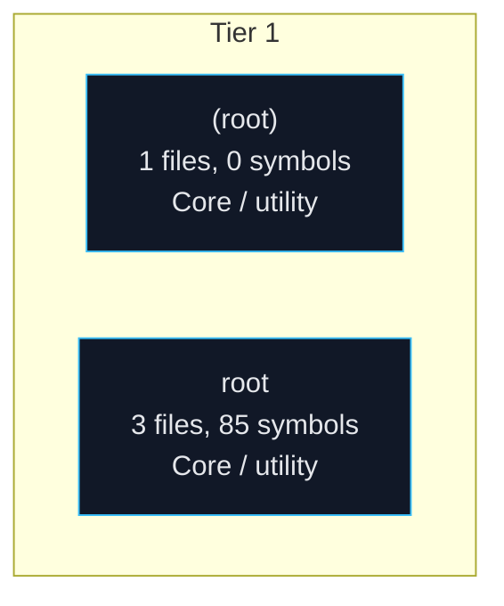
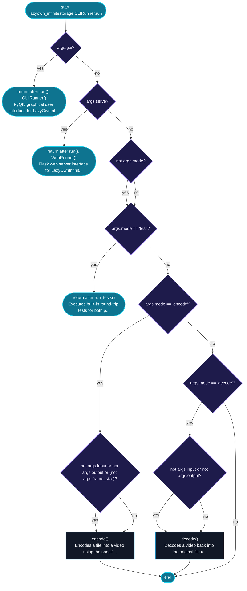
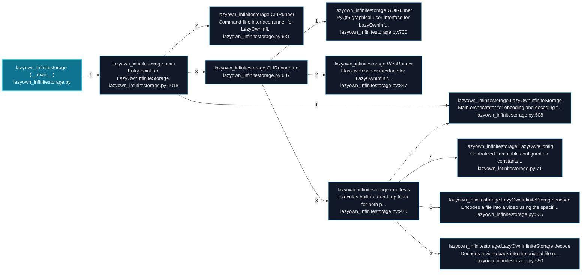

# LazyOwnInfiniteStorage Architecture and Execution Flows

[Back to index](index.md)

## Architecture Overview

2 components stacked in 1 dependency tiers (weighted Eades-Lin-Smyth ordering: arrows point from dependent to dependency, top to bottom). Labels are import counts, thick arrows the top quartile; 0 transitively implied edges are omitted. Dashed red arrows are upward dependencies: the smallest set of imports that closes every cycle and breaks the layering. Cyan components hold entry points. Interactive version: `readmenator-apidocs/index.html#/flows`.

---

## Execution Flows

Entry points are scored from `__main__` guards, `main` functions, entry-style names and files, and call-graph sources. Each flow walks resolved calls in call-site order (depth <= 4, <= 40 steps); numbers give the call order, dashed arrows revisit an already expanded callee, red arrows are recursion. Interactive version with zoom and per-node docs: `readmenator-apidocs/index.html#/flows`.

### `lazyown_infinitestorage.CLIRunner.run`

`lazyown_infinitestorage.py:637`, score 18: entry-style name `run`.

Control flow:

Call tree:

```mermaid
flowchart LR
    classDef default fill:#111827,stroke:#38bdf8,color:#e5e7eb;
    classDef entry fill:#0e7490,stroke:#22d3ee,color:#ecfeff,stroke-width:2px;
    n_lazyown_infinitestorage_py__run["lazyown_infinitestorage.CLIRunner.run<br/>lazyown_infinitestorage.py:637"]:::entry
    n_lazyown_infinitestorage_py__GUIRunner["lazyown_infinitestorage.GUIRunner<br/>PyQt5 graphical user interface for LazyOwnInf...<br/>lazyown_infinitestorage.py:700"]:::default
    n_lazyown_infinitestorage_py__WebRunner["lazyown_infinitestorage.WebRunner<br/>Flask web server interface for LazyOwnInfinit...<br/>lazyown_infinitestorage.py:847"]:::default
    n_lazyown_infinitestorage_py__run_tests["lazyown_infinitestorage.run_tests<br/>Executes built-in round-trip tests for both p...<br/>lazyown_infinitestorage.py:970"]:::default
    n_lazyown_infinitestorage_py__LazyOwnConfig["lazyown_infinitestorage.LazyOwnConfig<br/>Centralized immutable configuration constants...<br/>lazyown_infinitestorage.py:71"]:::default
    n_lazyown_infinitestorage_py__LazyOwnInfiniteStorage["lazyown_infinitestorage.LazyOwnInfiniteStorage<br/>Main orchestrator for encoding and decoding f...<br/>lazyown_infinitestorage.py:508"]:::default
    n_lazyown_infinitestorage_py__encode["lazyown_infinitestorage.LazyOwnInfiniteStorage.encode<br/>Encodes a file into a video using the specifi...<br/>lazyown_infinitestorage.py:525"]:::default
    n_lazyown_infinitestorage_py__validate_file_path["lazyown_infinitestorage.SecurityValidator.validate_file_path<br/>Resolves and validates an absolute file path.<br/>lazyown_infinitestorage.py:154"]:::default
    n_lazyown_infinitestorage_py__validate_size["lazyown_infinitestorage.SecurityValidator.validate_size<br/>Ensures the file size is within acceptable li...<br/>lazyown_infinitestorage.py:164"]:::default
    n_lazyown_infinitestorage_py___validate_encoding_parameters["lazyown_infinitestorage.LazyOwnInfiniteStorage._validate_...<br/>lazyown_infinitestorage.py:561"]:::default
    n_lazyown_infinitestorage_py__bits_to_frames["lazyown_infinitestorage.FrameEncoder.bits_to_frames<br/>Yields grayscale frames from a bit string.<br/>lazyown_infinitestorage.py:248"]:::default
    n_lazyown_infinitestorage_py___create_frame["lazyown_infinitestorage.FrameEncoder._create_frame<br/>lazyown_infinitestorage.py:263"]:::default
    n_lazyown_infinitestorage_py__encode_video["lazyown_infinitestorage.FFmpegPipeline.encode_video<br/>Encodes a generator of frames into a video fi...<br/>lazyown_infinitestorage.py:366"]:::default
    n_lazyown_infinitestorage_py__decode["lazyown_infinitestorage.LazyOwnInfiniteStorage.decode<br/>Decodes a video back into the original file u...<br/>lazyown_infinitestorage.py:550"]:::default
    n_lazyown_infinitestorage_py___detect_protocol["lazyown_infinitestorage.LazyOwnInfiniteStorage._detect_pr...<br/>lazyown_infinitestorage.py:571"]:::default
    n_lazyown_infinitestorage_py__get_video_info["lazyown_infinitestorage.FFmpegPipeline.get_video_info<br/>Retrieves native resolution and metadata from...<br/>lazyown_infinitestorage.py:311"]:::default
    n_lazyown_infinitestorage_py__extract_raw_frames["lazyown_infinitestorage.FFmpegPipeline.extract_raw_frames<br/>Extracts raw grayscale frames from a video fi...<br/>lazyown_infinitestorage.py:393"]:::default
    n_lazyown_infinitestorage_py__extract_bits_from_raw_frames["lazyown_infinitestorage.FrameDecoder.extract_bits_from_ra...<br/>Extracts a bit string from rawvideo grayscale...<br/>lazyown_infinitestorage.py:279"]:::default
    n_lazyown_infinitestorage_py__decode_data["lazyown_infinitestorage.ErrorCorrector.decode_data<br/>Decodes a Hamming(8,4) encoded byte sequence...<br/>lazyown_infinitestorage.py:200"]:::default
    n_lazyown_infinitestorage_py___decode_legacy["lazyown_infinitestorage.LazyOwnInfiniteStorage._decode_le...<br/>lazyown_infinitestorage.py:604"]:::default
    n_lazyown_infinitestorage_py__unpack_440["lazyown_infinitestorage.LegacyProtocolHandler.unpack<br/>lazyown_infinitestorage.py:440"]:::default
    n_lazyown_infinitestorage_py___decode_secure["lazyown_infinitestorage.LazyOwnInfiniteStorage._decode_se...<br/>lazyown_infinitestorage.py:617"]:::default
    n_lazyown_infinitestorage_py__unpack_480["lazyown_infinitestorage.SecureProtocolHandler.unpack<br/>lazyown_infinitestorage.py:480"]:::default
    n_lazyown_infinitestorage_py__run -->|"1"| n_lazyown_infinitestorage_py__GUIRunner
    n_lazyown_infinitestorage_py__run -->|"2"| n_lazyown_infinitestorage_py__WebRunner
    n_lazyown_infinitestorage_py__run -->|"3"| n_lazyown_infinitestorage_py__run_tests
    n_lazyown_infinitestorage_py__run_tests -->|"1"| n_lazyown_infinitestorage_py__LazyOwnConfig
    n_lazyown_infinitestorage_py__run_tests -->|"2"| n_lazyown_infinitestorage_py__LazyOwnInfiniteStorage
    n_lazyown_infinitestorage_py__run_tests -->|"3"| n_lazyown_infinitestorage_py__encode
    n_lazyown_infinitestorage_py__encode -->|"1"| n_lazyown_infinitestorage_py__validate_file_path
    n_lazyown_infinitestorage_py__encode -->|"2"| n_lazyown_infinitestorage_py__validate_size
    n_lazyown_infinitestorage_py__encode -->|"3"| n_lazyown_infinitestorage_py___validate_encoding_parameters
    n_lazyown_infinitestorage_py__encode -->|"4"| n_lazyown_infinitestorage_py__bits_to_frames
    n_lazyown_infinitestorage_py__bits_to_frames -->|"1"| n_lazyown_infinitestorage_py___create_frame
    n_lazyown_infinitestorage_py__encode -->|"5"| n_lazyown_infinitestorage_py__encode_video
    n_lazyown_infinitestorage_py__run_tests -->|"4"| n_lazyown_infinitestorage_py__decode
    n_lazyown_infinitestorage_py__decode -.-> n_lazyown_infinitestorage_py__validate_file_path
    n_lazyown_infinitestorage_py__decode -->|"1"| n_lazyown_infinitestorage_py___detect_protocol
    n_lazyown_infinitestorage_py___detect_protocol -->|"1"| n_lazyown_infinitestorage_py__get_video_info
    n_lazyown_infinitestorage_py___detect_protocol -->|"2"| n_lazyown_infinitestorage_py__extract_raw_frames
    n_lazyown_infinitestorage_py___detect_protocol -->|"3"| n_lazyown_infinitestorage_py__extract_bits_from_raw_frames
    n_lazyown_infinitestorage_py___detect_protocol -->|"4"| n_lazyown_infinitestorage_py__decode_data
    n_lazyown_infinitestorage_py__decode -->|"2"| n_lazyown_infinitestorage_py___decode_legacy
    n_lazyown_infinitestorage_py___decode_legacy -->|"1"| n_lazyown_infinitestorage_py__extract_raw_frames
    n_lazyown_infinitestorage_py___decode_legacy -->|"2"| n_lazyown_infinitestorage_py__extract_bits_from_raw_frames
    n_lazyown_infinitestorage_py___decode_legacy -->|"3"| n_lazyown_infinitestorage_py__unpack_440
    n_lazyown_infinitestorage_py__decode -->|"3"| n_lazyown_infinitestorage_py___decode_secure
    n_lazyown_infinitestorage_py___decode_secure -->|"1"| n_lazyown_infinitestorage_py__extract_raw_frames
    n_lazyown_infinitestorage_py___decode_secure -->|"2"| n_lazyown_infinitestorage_py__extract_bits_from_raw_frames
    n_lazyown_infinitestorage_py___decode_secure -->|"3"| n_lazyown_infinitestorage_py__unpack_480
```

### `lazyown_infinitestorage (__main__)`

`lazyown_infinitestorage.py:1026`, score 8: `if __name__ == "__main__"` guard.

Call tree:

---
