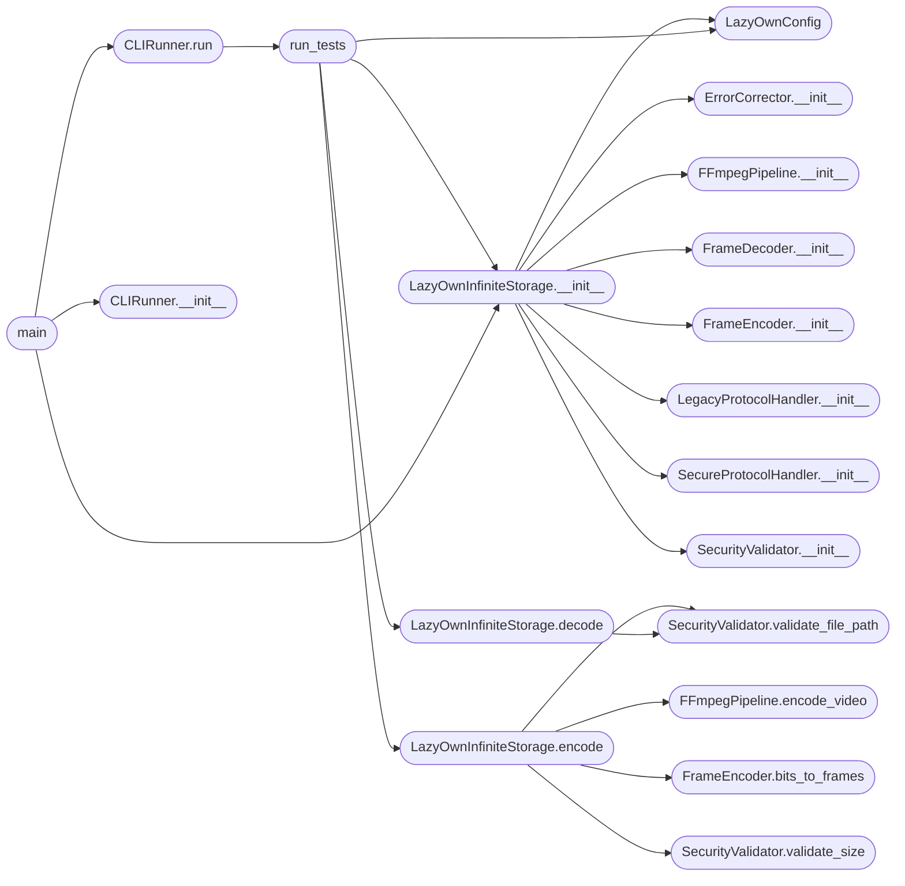

# `lazyown_infinitestorage`

> Source: [lazyown_infinitestorage.py:1](../../lazyown_infinitestorage.py#L1) | language `py` | coverage 77.8% | [API index](../index.md)

LazyOwnInfiniteStorage - Production-grade file-to-video encoder/decoder.

## Contents

- **Classes:** [`LazyOwnConfig`](#lazyownconfig), [`SecurityValidator`](#securityvalidator), [`ErrorCorrector`](#errorcorrector), [`FrameEncoder`](#frameencoder), [`FrameDecoder`](#framedecoder), [`FFmpegPipeline`](#ffmpegpipeline), [`ProtocolHandler`](#protocolhandler), [`LegacyProtocolHandler`](#legacyprotocolhandler), [`SecureProtocolHandler`](#secureprotocolhandler), [`LazyOwnInfiniteStorage`](#lazyowninfinitestorage), [`CLIRunner`](#clirunner)
- **Functions:** [`run_tests`](#run_tests), [`main`](#main)
- **Constants:** [`BANNER`](#banner)

## Type Diagram

```mermaid
classDiagram
    direction LR
    class LazyOwnConfig
    LazyOwnConfig : MAGIC_BYTES
    LazyOwnConfig : PROTOCOL_VERSION_LEGACY
    LazyOwnConfig : PROTOCOL_VERSION_SECURE
    LazyOwnConfig : DEFAULT_FRAME_WIDTH
    LazyOwnConfig : DEFAULT_FRAME_HEIGHT
    LazyOwnConfig : DEFAULT_FPS
    LazyOwnConfig : DEFAULT_BLOCK_SIZE
    LazyOwnConfig : MIN_FRAME_WIDTH
    LazyOwnConfig : MIN_FRAME_HEIGHT
    LazyOwnConfig : MAX_FRAME_WIDTH
    LazyOwnConfig : MAX_FRAME_HEIGHT
    LazyOwnConfig : MIN_BLOCK_SIZE
    LazyOwnConfig : MAX_BLOCK_SIZE
    LazyOwnConfig : MIN_FPS
    LazyOwnConfig : MAX_FPS
    LazyOwnConfig : MAX_INPUT_FILE_SIZE
    LazyOwnConfig : HEADER_OFFSET_MAGIC
    LazyOwnConfig : HEADER_SIZE_MAGIC
    LazyOwnConfig : HEADER_OFFSET_VERSION
    LazyOwnConfig : HEADER_SIZE_VERSION
    LazyOwnConfig : HEADER_OFFSET_FLAGS
    LazyOwnConfig : HEADER_SIZE_FLAGS
    LazyOwnConfig : HEADER_OFFSET_RESERVED
    LazyOwnConfig : HEADER_SIZE_RESERVED
    class SecurityValidator
    SecurityValidator : __init__()
    SecurityValidator : validate_file_path()
    SecurityValidator : validate_size()
    SecurityValidator : sanitize_filename()
    SecurityValidator : validate_extension()
    class ErrorCorrector
    ErrorCorrector : __init__()
    ErrorCorrector : encode_data()
    ErrorCorrector : decode_data()
    class FrameEncoder
    FrameEncoder : __init__()
    FrameEncoder : bits_to_frames()
    class FrameDecoder
    FrameDecoder : __init__()
    FrameDecoder : extract_bits_from_raw_frames()
    class FFmpegPipeline
    FFmpegPipeline : __init__()
    FFmpegPipeline : get_video_info()
    FFmpegPipeline : get_metadata()
    FFmpegPipeline : encode_video()
    FFmpegPipeline : extract_raw_frames()
    class ProtocolHandler
    ProtocolHandler : pack()
    ProtocolHandler : unpack()
    class LegacyProtocolHandler
    LegacyProtocolHandler : __init__()
    LegacyProtocolHandler : pack()
    LegacyProtocolHandler : unpack()
    class SecureProtocolHandler
    SecureProtocolHandler : __init__()
    SecureProtocolHandler : pack()
    SecureProtocolHandler : unpack()
    class LazyOwnInfiniteStorage
    LazyOwnInfiniteStorage : __init__()
    LazyOwnInfiniteStorage : create_web_runner()
    LazyOwnInfiniteStorage : encode()
    LazyOwnInfiniteStorage : decode()
    class CLIRunner
    CLIRunner : __init__()
    CLIRunner : run()
    ProtocolHandler <|-- LegacyProtocolHandler
    ProtocolHandler <|-- SecureProtocolHandler
```



## Call Graph

Solid arrows stay in this module, dashed arrows leave it.



## Classes

<a id="lazyownconfig"></a>

### `LazyOwnConfig`

`class` | [lazyown_infinitestorage.py:71](../../lazyown_infinitestorage.py#L71)

```python
class LazyOwnConfig
```

Centralized immutable configuration constants for LazyOwnInfiniteStorage.

**Attributes**

| Name | Type | Default | Description |
|---|---|---|---|
| [`MAGIC_BYTES`](#lazyownconfig-magic_bytes) |  | `b'LAZY'` |  |
| [`PROTOCOL_VERSION_LEGACY`](#lazyownconfig-protocol_version_legacy) |  | `1` |  |
| [`PROTOCOL_VERSION_SECURE`](#lazyownconfig-protocol_version_secure) |  | `2` |  |
| [`DEFAULT_FRAME_WIDTH`](#lazyownconfig-default_frame_width) |  | `640` |  |
| [`DEFAULT_FRAME_HEIGHT`](#lazyownconfig-default_frame_height) |  | `480` |  |
| [`DEFAULT_FPS`](#lazyownconfig-default_fps) |  | `30` |  |
| [`DEFAULT_BLOCK_SIZE`](#lazyownconfig-default_block_size) |  | `4` |  |
| [`MIN_FRAME_WIDTH`](#lazyownconfig-min_frame_width) |  | `64` |  |
| [`MIN_FRAME_HEIGHT`](#lazyownconfig-min_frame_height) |  | `64` |  |
| [`MAX_FRAME_WIDTH`](#lazyownconfig-max_frame_width) |  | `4096` |  |
| [`MAX_FRAME_HEIGHT`](#lazyownconfig-max_frame_height) |  | `4096` |  |
| [`MIN_BLOCK_SIZE`](#lazyownconfig-min_block_size) |  | `1` |  |
| [`MAX_BLOCK_SIZE`](#lazyownconfig-max_block_size) |  | `64` |  |
| [`MIN_FPS`](#lazyownconfig-min_fps) |  | `1` |  |
| [`MAX_FPS`](#lazyownconfig-max_fps) |  | `120` |  |
| [`MAX_INPUT_FILE_SIZE`](#lazyownconfig-max_input_file_size) |  | `2 * 1024 * 1024 * 1024` |  |
| [`HEADER_OFFSET_MAGIC`](#lazyownconfig-header_offset_magic) |  | `0` |  |
| [`HEADER_SIZE_MAGIC`](#lazyownconfig-header_size_magic) |  | `4` |  |
| [`HEADER_OFFSET_VERSION`](#lazyownconfig-header_offset_version) |  | `4` |  |
| [`HEADER_SIZE_VERSION`](#lazyownconfig-header_size_version) |  | `1` |  |
| [`HEADER_OFFSET_FLAGS`](#lazyownconfig-header_offset_flags) |  | `5` |  |
| [`HEADER_SIZE_FLAGS`](#lazyownconfig-header_size_flags) |  | `1` |  |
| [`HEADER_OFFSET_RESERVED`](#lazyownconfig-header_offset_reserved) |  | `6` |  |
| [`HEADER_SIZE_RESERVED`](#lazyownconfig-header_size_reserved) |  | `2` |  |
| [`HEADER_OFFSET_FILE_SIZE`](#lazyownconfig-header_offset_file_size) |  | `8` |  |
| [`HEADER_SIZE_FILE_SIZE`](#lazyownconfig-header_size_file_size) |  | `8` |  |
| [`HEADER_OFFSET_WIDTH`](#lazyownconfig-header_offset_width) |  | `16` |  |
| [`HEADER_SIZE_WIDTH`](#lazyownconfig-header_size_width) |  | `4` |  |
| [`HEADER_OFFSET_HEIGHT`](#lazyownconfig-header_offset_height) |  | `20` |  |
| [`HEADER_SIZE_HEIGHT`](#lazyownconfig-header_size_height) |  | `4` |  |
| [`HEADER_OFFSET_BLOCK_SIZE`](#lazyownconfig-header_offset_block_size) |  | `24` |  |
| [`HEADER_SIZE_BLOCK_SIZE`](#lazyownconfig-header_size_block_size) |  | `2` |  |
| [`HEADER_OFFSET_FPS`](#lazyownconfig-header_offset_fps) |  | `26` |  |
| [`HEADER_SIZE_FPS`](#lazyownconfig-header_size_fps) |  | `2` |  |
| [`HEADER_OFFSET_PAYLOAD_CRC`](#lazyownconfig-header_offset_payload_crc) |  | `28` |  |
| [`HEADER_SIZE_PAYLOAD_CRC`](#lazyownconfig-header_size_payload_crc) |  | `4` |  |
| [`HEADER_OFFSET_HEADER_CRC`](#lazyownconfig-header_offset_header_crc) |  | `32` |  |
| [`HEADER_SIZE_HEADER_CRC`](#lazyownconfig-header_size_header_crc) |  | `4` |  |
| [`HEADER_TOTAL_SIZE`](#lazyownconfig-header_total_size) |  | `36` |  |
| [`HAMMING_ENCODED_HEADER_BYTES`](#lazyownconfig-hamming_encoded_header_bytes) |  | `HEADER_TOTAL_SIZE * 2` |  |
| [`HAMMING_ENCODED_HEADER_BITS`](#lazyownconfig-hamming_encoded_header_bits) |  | `HAMMING_ENCODED_HEADER_BYTES * 8` |  |
| [`PROTOCOL_DETECTION_BITS`](#lazyownconfig-protocol_detection_bits) |  | `2048` |  |
| [`CANDIDATE_BLOCK_SIZES`](#lazyownconfig-candidate_block_sizes) |  | `[4, 8, 16, 2, 1, 32]` |  |
| [`TEMP_DIR_PREFIX`](#lazyownconfig-temp_dir_prefix) |  | `'lazyown_'` |  |
| [`END_MARKER_LEGACY`](#lazyownconfig-end_marker_legacy) |  | `b'\x80'` |  |
| [`FFMPEG_ENCODE_INPUT_FORMAT`](#lazyownconfig-ffmpeg_encode_input_format) |  | `'rawvideo'` |  |
| [`FFMPEG_ENCODE_PIXEL_FORMAT`](#lazyownconfig-ffmpeg_encode_pixel_format) |  | `'gray'` |  |
| [`FFMPEG_ENCODE_CODEC`](#lazyownconfig-ffmpeg_encode_codec) |  | `'libx264'` |  |
| [`FFMPEG_ENCODE_PIXEL_FORMAT_OUTPUT`](#lazyownconfig-ffmpeg_encode_pixel_format_output) |  | `'yuv420p'` |  |
| [`FFMPEG_ENCODE_MOVFLAGS`](#lazyownconfig-ffmpeg_encode_movflags) |  | `'faststart'` |  |
| [`FFMPEG_DECODE_PIX_FMT`](#lazyownconfig-ffmpeg_decode_pix_fmt) |  | `'gray'` |  |
| [`FFMPEG_DECODE_FORMAT`](#lazyownconfig-ffmpeg_decode_format) |  | `'rawvideo'` |  |
| [`ALLOWED_ENCODE_EXTENSIONS`](#lazyownconfig-allowed_encode_extensions) |  | `{'.zip', '.tar', '.gz', '.bz2', '.xz', '.7z', '.bin', '.dat', ''}` |  |
| [`ALLOWED_DECODE_EXTENSIONS`](#lazyownconfig-allowed_decode_extensions) |  | `{'.mp4', '.avi', '.mkv', '.mov'}` |  |
| [`ALLOWED_OUTPUT_ENCODE_EXTENSIONS`](#lazyownconfig-allowed_output_encode_extensions) |  | `{'.mp4'}` |  |
| [`ALLOWED_OUTPUT_DECODE_EXTENSIONS`](#lazyownconfig-allowed_output_decode_extensions) |  | `{'.zip', '.bin', '.dat'}` |  |
| [`WEB_MAX_CONTENT_LENGTH`](#lazyownconfig-web_max_content_length) |  | `2 * 1024 * 1024 * 1024` |  |
| [`WEB_UPLOAD_FOLDER`](#lazyownconfig-web_upload_folder) |  | `'uploads'` |  |
| [`WEB_DOWNLOAD_FOLDER`](#lazyownconfig-web_download_folder) |  | `'downloads'` |  |
| [`WEB_SECRET_KEY_ENV`](#lazyownconfig-web_secret_key_env) |  | `'LAZYOWN_SECRET_KEY'` |  |

---

<a id="securityvalidator"></a>

### `SecurityValidator`

`class` | [lazyown_infinitestorage.py:148](../../lazyown_infinitestorage.py#L148)

```python
class SecurityValidator
```

Validates file paths and inputs to prevent path traversal and abuse.

**Members**

| Member | Kind | Summary |
|---|---|---|
| [`__init__`](#securityvalidator-__init__) | constructor |  |
| [`validate_file_path`](#securityvalidator-validate_file_path) | method | Resolves and validates an absolute file path. |
| [`validate_size`](#securityvalidator-validate_size) | method | Ensures the file size is within acceptable limits. |
| [`sanitize_filename`](#securityvalidator-sanitize_filename) | method | Sanitizes a filename to remove unsafe characters. |
| [`validate_extension`](#securityvalidator-validate_extension) | method | Ensures the file extension is in the allowed set. |

<a id="securityvalidator-__init__"></a>

#### `SecurityValidator.__init__`

`constructor` | [lazyown_infinitestorage.py:151](../../lazyown_infinitestorage.py#L151)

```python
def __init__(self, config: LazyOwnConfig)
```

**Parameters**

| Name | Type | Default | Description |
|---|---|---|---|
| `config` | `LazyOwnConfig` |  |  |

*Called by:* [`LazyOwnInfiniteStorage.__init__`](#lazyowninfinitestorage-__init__)

<a id="securityvalidator-validate_file_path"></a>

#### `SecurityValidator.validate_file_path`

`method` | [lazyown_infinitestorage.py:154](../../lazyown_infinitestorage.py#L154)

```python
def validate_file_path(self, file_path: str, must_exist: bool = False) -> str
```

Resolves and validates an absolute file path.

**Parameters**

| Name | Type | Default | Description |
|---|---|---|---|
| `file_path` | `str` |  |  |
| `must_exist` | `bool` | `False` |  |

**Returns:** `str`

**Raises**

- `FileNotFoundError`: (raised in the body, not documented)
- `ValueError`: (raised in the body, not documented)

*Called by:* [`LazyOwnInfiniteStorage.decode`](#lazyowninfinitestorage-decode), [`LazyOwnInfiniteStorage.encode`](#lazyowninfinitestorage-encode)

<a id="securityvalidator-validate_size"></a>

#### `SecurityValidator.validate_size`

`method` | [lazyown_infinitestorage.py:164](../../lazyown_infinitestorage.py#L164)

```python
def validate_size(self, size: int) -> None
```

Ensures the file size is within acceptable limits.

**Parameters**

| Name | Type | Default | Description |
|---|---|---|---|
| `size` | `int` |  |  |

**Raises**

- `ValueError`: (raised in the body, not documented)

*Called by:* [`LazyOwnInfiniteStorage.encode`](#lazyowninfinitestorage-encode)

<a id="securityvalidator-sanitize_filename"></a>

#### `SecurityValidator.sanitize_filename`

`method` | [lazyown_infinitestorage.py:169](../../lazyown_infinitestorage.py#L169)

```python
def sanitize_filename(self, filename: str) -> str
```

Sanitizes a filename to remove unsafe characters.

**Parameters**

| Name | Type | Default | Description |
|---|---|---|---|
| `filename` | `str` |  |  |

**Returns:** `str`

<a id="securityvalidator-validate_extension"></a>

#### `SecurityValidator.validate_extension`

`method` | [lazyown_infinitestorage.py:177](../../lazyown_infinitestorage.py#L177)

```python
def validate_extension(self, file_path: str, allowed_extensions: set) -> None
```

Ensures the file extension is in the allowed set.

**Parameters**

| Name | Type | Default | Description |
|---|---|---|---|
| `file_path` | `str` |  |  |
| `allowed_extensions` | `set` |  |  |

**Raises**

- `ValueError`: (raised in the body, not documented)

---

<a id="errorcorrector"></a>

### `ErrorCorrector`

`class` | [lazyown_infinitestorage.py:184](../../lazyown_infinitestorage.py#L184)

```python
class ErrorCorrector
```

Implements Hamming(8,4) extended error correction for byte streams.

**Members**

| Member | Kind | Summary |
|---|---|---|
| [`__init__`](#errorcorrector-__init__) | constructor |  |
| [`encode_data`](#errorcorrector-encode_data) | method | Encodes a byte sequence using Hamming(8,4) correction. |
| [`decode_data`](#errorcorrector-decode_data) | method | Decodes a Hamming(8,4) encoded byte sequence with single-bit error correction. |

<a id="errorcorrector-__init__"></a>

#### `ErrorCorrector.__init__`

`constructor` | [lazyown_infinitestorage.py:187](../../lazyown_infinitestorage.py#L187)

```python
def __init__(self, config: LazyOwnConfig)
```

**Parameters**

| Name | Type | Default | Description |
|---|---|---|---|
| `config` | `LazyOwnConfig` |  |  |

*Called by:* [`LazyOwnInfiniteStorage.__init__`](#lazyowninfinitestorage-__init__)

<a id="errorcorrector-encode_data"></a>

#### `ErrorCorrector.encode_data`

`method` | [lazyown_infinitestorage.py:190](../../lazyown_infinitestorage.py#L190)

```python
def encode_data(self, data: bytes) -> bytes
```

Encodes a byte sequence using Hamming(8,4) correction.

**Parameters**

| Name | Type | Default | Description |
|---|---|---|---|
| `data` | `bytes` |  |  |

**Returns:** `bytes`

<a id="errorcorrector-decode_data"></a>

#### `ErrorCorrector.decode_data`

`method` | [lazyown_infinitestorage.py:200](../../lazyown_infinitestorage.py#L200)

```python
def decode_data(self, data: bytes) -> bytes
```

Decodes a Hamming(8,4) encoded byte sequence with single-bit error correction.

**Parameters**

| Name | Type | Default | Description |
|---|---|---|---|
| `data` | `bytes` |  |  |

**Returns:** `bytes`

**Raises**

- `ValueError`: (raised in the body, not documented)

---

<a id="frameencoder"></a>

### `FrameEncoder`

`class` | [lazyown_infinitestorage.py:242](../../lazyown_infinitestorage.py#L242)

```python
class FrameEncoder
```

Encodes bit strings into numpy grayscale frames.

**Members**

| Member | Kind | Summary |
|---|---|---|
| [`__init__`](#frameencoder-__init__) | constructor |  |
| [`bits_to_frames`](#frameencoder-bits_to_frames) | method | Yields grayscale frames from a bit string. |

<a id="frameencoder-__init__"></a>

#### `FrameEncoder.__init__`

`constructor` | [lazyown_infinitestorage.py:245](../../lazyown_infinitestorage.py#L245)

```python
def __init__(self, config: LazyOwnConfig)
```

**Parameters**

| Name | Type | Default | Description |
|---|---|---|---|
| `config` | `LazyOwnConfig` |  |  |

*Called by:* [`LazyOwnInfiniteStorage.__init__`](#lazyowninfinitestorage-__init__)

<a id="frameencoder-bits_to_frames"></a>

#### `FrameEncoder.bits_to_frames`

`method` `generator` | [lazyown_infinitestorage.py:248](../../lazyown_infinitestorage.py#L248)

```python
def bits_to_frames(self, bit_string: str, frame_width: int, frame_height: int, block_size: int) -> Generator[np.ndarray, None, None]
```

Yields grayscale frames from a bit string.

**Parameters**

| Name | Type | Default | Description |
|---|---|---|---|
| `bit_string` | `str` |  |  |
| `frame_width` | `int` |  |  |
| `frame_height` | `int` |  |  |
| `block_size` | `int` |  |  |

**Returns:** `Generator[np.ndarray, None, None]`

*Called by:* [`LazyOwnInfiniteStorage.encode`](#lazyowninfinitestorage-encode)

---

<a id="framedecoder"></a>

### `FrameDecoder`

`class` | [lazyown_infinitestorage.py:273](../../lazyown_infinitestorage.py#L273)

```python
class FrameDecoder
```

Decodes grayscale frames into bit strings.

**Members**

| Member | Kind | Summary |
|---|---|---|
| [`__init__`](#framedecoder-__init__) | constructor |  |
| [`extract_bits_from_raw_frames`](#framedecoder-extract_bits_from_raw_frames) | method | Extracts a bit string from rawvideo grayscale bytes. |

<a id="framedecoder-__init__"></a>

#### `FrameDecoder.__init__`

`constructor` | [lazyown_infinitestorage.py:276](../../lazyown_infinitestorage.py#L276)

```python
def __init__(self, config: LazyOwnConfig)
```

**Parameters**

| Name | Type | Default | Description |
|---|---|---|---|
| `config` | `LazyOwnConfig` |  |  |

*Called by:* [`LazyOwnInfiniteStorage.__init__`](#lazyowninfinitestorage-__init__)

<a id="framedecoder-extract_bits_from_raw_frames"></a>

#### `FrameDecoder.extract_bits_from_raw_frames`

`method` | [lazyown_infinitestorage.py:279](../../lazyown_infinitestorage.py#L279)

```python
def extract_bits_from_raw_frames(self, raw_bytes: bytes, width: int, height: int, block_size: int, expected_bits: Optional[int] = None) -> str
```

Extracts a bit string from rawvideo grayscale bytes.

**Parameters**

| Name | Type | Default | Description |
|---|---|---|---|
| `raw_bytes` | `bytes` |  |  |
| `width` | `int` |  |  |
| `height` | `int` |  |  |
| `block_size` | `int` |  |  |
| `expected_bits` | `Optional[int]` | `None` |  |

**Returns:** `str`

**Raises**

- `ValueError`: (raised in the body, not documented)

---

<a id="ffmpegpipeline"></a>

### `FFmpegPipeline`

`class` | [lazyown_infinitestorage.py:305](../../lazyown_infinitestorage.py#L305)

```python
class FFmpegPipeline
```

Manages FFmpeg subprocess communication without intermediate frame files.

**Members**

| Member | Kind | Summary |
|---|---|---|
| [`__init__`](#ffmpegpipeline-__init__) | constructor |  |
| [`get_video_info`](#ffmpegpipeline-get_video_info) | method | Retrieves native resolution and metadata from a video file. |
| [`get_metadata`](#ffmpegpipeline-get_metadata) | method | Extracts custom lazyown metadata from a video file using ffprobe. |
| [`encode_video`](#ffmpegpipeline-encode_video) | method | Encodes a generator of frames into a video file via FFmpeg stdin. |
| [`extract_raw_frames`](#ffmpegpipeline-extract_raw_frames) | method | Extracts raw grayscale frames from a video file via FFmpeg stdout. |

<a id="ffmpegpipeline-__init__"></a>

#### `FFmpegPipeline.__init__`

`constructor` | [lazyown_infinitestorage.py:308](../../lazyown_infinitestorage.py#L308)

```python
def __init__(self, config: LazyOwnConfig)
```

**Parameters**

| Name | Type | Default | Description |
|---|---|---|---|
| `config` | `LazyOwnConfig` |  |  |

*Called by:* [`LazyOwnInfiniteStorage.__init__`](#lazyowninfinitestorage-__init__)

<a id="ffmpegpipeline-get_video_info"></a>

#### `FFmpegPipeline.get_video_info`

`method` | [lazyown_infinitestorage.py:311](../../lazyown_infinitestorage.py#L311)

```python
def get_video_info(self, input_path: str) -> dict
```

Retrieves native resolution and metadata from a video file.

**Parameters**

| Name | Type | Default | Description |
|---|---|---|---|
| `input_path` | `str` |  |  |

**Returns:** `dict`

**Raises**

- `RuntimeError`: (raised in the body, not documented)

<a id="ffmpegpipeline-get_metadata"></a>

#### `FFmpegPipeline.get_metadata`

`method` | [lazyown_infinitestorage.py:347](../../lazyown_infinitestorage.py#L347)

```python
def get_metadata(self, input_path: str) -> dict
```

Extracts custom lazyown metadata from a video file using ffprobe.

**Parameters**

| Name | Type | Default | Description |
|---|---|---|---|
| `input_path` | `str` |  |  |

**Returns:** `dict`

<a id="ffmpegpipeline-encode_video"></a>

#### `FFmpegPipeline.encode_video`

`method` | [lazyown_infinitestorage.py:366](../../lazyown_infinitestorage.py#L366)

```python
def encode_video(self, frame_generator: Generator[np.ndarray, None, None], output_path: str, frame_width: int, frame_height: int, fps: int) -> None
```

Encodes a generator of frames into a video file via FFmpeg stdin.

**Parameters**

| Name | Type | Default | Description |
|---|---|---|---|
| `frame_generator` | `Generator[np.ndarray, None, None]` |  |  |
| `output_path` | `str` |  |  |
| `frame_width` | `int` |  |  |
| `frame_height` | `int` |  |  |
| `fps` | `int` |  |  |

**Raises**

- `RuntimeError`: (raised in the body, not documented)

*Called by:* [`LazyOwnInfiniteStorage.encode`](#lazyowninfinitestorage-encode)

<a id="ffmpegpipeline-extract_raw_frames"></a>

#### `FFmpegPipeline.extract_raw_frames`

`method` | [lazyown_infinitestorage.py:393](../../lazyown_infinitestorage.py#L393)

```python
def extract_raw_frames(self, input_path: str, target_width: Optional[int] = None, target_height: Optional[int] = None, max_frames: Optional[int] = None) -> bytes
```

Extracts raw grayscale frames from a video file via FFmpeg stdout.

**Parameters**

| Name | Type | Default | Description |
|---|---|---|---|
| `input_path` | `str` |  |  |
| `target_width` | `Optional[int]` | `None` |  |
| `target_height` | `Optional[int]` | `None` |  |
| `max_frames` | `Optional[int]` | `None` |  |

**Returns:** `bytes`

**Raises**

- `RuntimeError`: (raised in the body, not documented)

---

<a id="protocolhandler"></a>

### `ProtocolHandler`

`class` | [lazyown_infinitestorage.py:417](../../lazyown_infinitestorage.py#L417)

```python
class ProtocolHandler
```

Subclasses: [`LegacyProtocolHandler`](#legacyprotocolhandler), [`SecureProtocolHandler`](#secureprotocolhandler)

Abstract base for encoding and decoding protocol implementations.

**Members**

| Member | Kind | Summary |
|---|---|---|
| [`pack`](#protocolhandler-pack) | method | Packs raw data into a bit string. |
| [`unpack`](#protocolhandler-unpack) | method | Unpacks a bit string into raw data. |

<a id="protocolhandler-pack"></a>

#### `ProtocolHandler.pack`

`method` | [lazyown_infinitestorage.py:420](../../lazyown_infinitestorage.py#L420)

```python
def pack(self, data: bytes, frame_width: int, frame_height: int, block_size: int, fps: int) -> str
```

Packs raw data into a bit string.

**Parameters**

| Name | Type | Default | Description |
|---|---|---|---|
| `data` | `bytes` |  |  |
| `frame_width` | `int` |  |  |
| `frame_height` | `int` |  |  |
| `block_size` | `int` |  |  |
| `fps` | `int` |  |  |

**Returns:** `str`

**Raises**

- `NotImplementedError`: (raised in the body, not documented)

<a id="protocolhandler-unpack"></a>

#### `ProtocolHandler.unpack`

`method` | [lazyown_infinitestorage.py:424](../../lazyown_infinitestorage.py#L424)

```python
def unpack(self, bit_string: str, block_size: int, **kwargs) -> bytes
```

Unpacks a bit string into raw data.

**Parameters**

| Name | Type | Default | Description |
|---|---|---|---|
| `bit_string` | `str` |  |  |
| `block_size` | `int` |  |  |
| `**kwargs` |  |  |  |

**Returns:** `bytes`

**Raises**

- `NotImplementedError`: (raised in the body, not documented)

---

<a id="legacyprotocolhandler"></a>

### `LegacyProtocolHandler`

`class` | [lazyown_infinitestorage.py:429](../../lazyown_infinitestorage.py#L429)

```python
class LegacyProtocolHandler(ProtocolHandler)
```

Bases: [`ProtocolHandler`](#protocolhandler)

Implements the original v1 protocol with filename-based resolution and end marker.

**Members**

| Member | Kind | Summary |
|---|---|---|
| [`__init__`](#legacyprotocolhandler-__init__) | constructor |  |
| [`pack`](#legacyprotocolhandler-pack) | method | Packs raw data into a bit string. |
| [`unpack`](#legacyprotocolhandler-unpack) | method | Unpacks a bit string into raw data. |

<a id="legacyprotocolhandler-__init__"></a>

#### `LegacyProtocolHandler.__init__`

`constructor` | [lazyown_infinitestorage.py:432](../../lazyown_infinitestorage.py#L432)

```python
def __init__(self, config: LazyOwnConfig)
```

**Parameters**

| Name | Type | Default | Description |
|---|---|---|---|
| `config` | `LazyOwnConfig` |  |  |

*Called by:* [`LazyOwnInfiniteStorage.__init__`](#lazyowninfinitestorage-__init__)

<a id="legacyprotocolhandler-pack"></a>

#### `LegacyProtocolHandler.pack`

`method` | [lazyown_infinitestorage.py:435](../../lazyown_infinitestorage.py#L435)

```python
def pack(self, data: bytes, frame_width: int, frame_height: int, block_size: int, fps: int) -> str
```

Packs raw data into a bit string.

**Parameters**

| Name | Type | Default | Description |
|---|---|---|---|
| `data` | `bytes` |  |  |
| `frame_width` | `int` |  |  |
| `frame_height` | `int` |  |  |
| `block_size` | `int` |  |  |
| `fps` | `int` |  |  |

**Returns:** `str`

> **Inherited:** Documentation from [`ProtocolHandler.pack`](#protocolhandler-pack) (lazyown_infinitestorage.py:420).

<a id="legacyprotocolhandler-unpack"></a>

#### `LegacyProtocolHandler.unpack`

`method` | [lazyown_infinitestorage.py:440](../../lazyown_infinitestorage.py#L440)

```python
def unpack(self, bit_string: str, block_size: int, **kwargs) -> bytes
```

Unpacks a bit string into raw data.

**Parameters**

| Name | Type | Default | Description |
|---|---|---|---|
| `bit_string` | `str` |  |  |
| `block_size` | `int` |  |  |
| `**kwargs` |  |  |  |

**Returns:** `bytes`

> **Inherited:** Documentation from [`ProtocolHandler.unpack`](#protocolhandler-unpack) (lazyown_infinitestorage.py:424).

---

<a id="secureprotocolhandler"></a>

### `SecureProtocolHandler`

`class` | [lazyown_infinitestorage.py:454](../../lazyown_infinitestorage.py#L454)

```python
class SecureProtocolHandler(ProtocolHandler)
```

Bases: [`ProtocolHandler`](#protocolhandler)

Implements the v2 protocol with structured headers, CRC32, and Hamming error correction.

**Members**

| Member | Kind | Summary |
|---|---|---|
| [`__init__`](#secureprotocolhandler-__init__) | constructor |  |
| [`pack`](#secureprotocolhandler-pack) | method | Packs raw data into a bit string. |
| [`unpack`](#secureprotocolhandler-unpack) | method | Unpacks a bit string into raw data. |

<a id="secureprotocolhandler-__init__"></a>

#### `SecureProtocolHandler.__init__`

`constructor` | [lazyown_infinitestorage.py:457](../../lazyown_infinitestorage.py#L457)

```python
def __init__(self, config: LazyOwnConfig, corrector: ErrorCorrector)
```

**Parameters**

| Name | Type | Default | Description |
|---|---|---|---|
| `config` | `LazyOwnConfig` |  |  |
| `corrector` | `ErrorCorrector` |  |  |

*Called by:* [`LazyOwnInfiniteStorage.__init__`](#lazyowninfinitestorage-__init__)

<a id="secureprotocolhandler-pack"></a>

#### `SecureProtocolHandler.pack`

`method` | [lazyown_infinitestorage.py:461](../../lazyown_infinitestorage.py#L461)

```python
def pack(self, data: bytes, frame_width: int, frame_height: int, block_size: int, fps: int) -> str
```

Packs raw data into a bit string.

**Parameters**

| Name | Type | Default | Description |
|---|---|---|---|
| `data` | `bytes` |  |  |
| `frame_width` | `int` |  |  |
| `frame_height` | `int` |  |  |
| `block_size` | `int` |  |  |
| `fps` | `int` |  |  |

**Returns:** `str`

> **Inherited:** Documentation from [`ProtocolHandler.pack`](#protocolhandler-pack) (lazyown_infinitestorage.py:420).

<a id="secureprotocolhandler-unpack"></a>

#### `SecureProtocolHandler.unpack`

`method` | [lazyown_infinitestorage.py:480](../../lazyown_infinitestorage.py#L480)

```python
def unpack(self, bit_string: str, block_size: int, **kwargs) -> bytes
```

Unpacks a bit string into raw data.

**Parameters**

| Name | Type | Default | Description |
|---|---|---|---|
| `bit_string` | `str` |  |  |
| `block_size` | `int` |  |  |
| `**kwargs` |  |  |  |

**Returns:** `bytes`

**Raises**

- `ValueError`: (raised in the body, not documented)

> **Inherited:** Documentation from [`ProtocolHandler.unpack`](#protocolhandler-unpack) (lazyown_infinitestorage.py:424).

---

<a id="lazyowninfinitestorage"></a>

### `LazyOwnInfiniteStorage`

`class` | [lazyown_infinitestorage.py:508](../../lazyown_infinitestorage.py#L508)

```python
class LazyOwnInfiniteStorage
```

Main orchestrator for encoding and decoding files to and from video.

**Members**

| Member | Kind | Summary |
|---|---|---|
| [`__init__`](#lazyowninfinitestorage-__init__) | constructor |  |
| [`create_web_runner`](#lazyowninfinitestorage-create_web_runner) | method | Return a WebRunner for WSGI or local web server use. |
| [`encode`](#lazyowninfinitestorage-encode) | method | Encodes a file into a video using the specified protocol. |
| [`decode`](#lazyowninfinitestorage-decode) | method | Decodes a video back into the original file using the specified protocol. |

<a id="lazyowninfinitestorage-__init__"></a>

#### `LazyOwnInfiniteStorage.__init__`

`constructor` | [lazyown_infinitestorage.py:511](../../lazyown_infinitestorage.py#L511)

```python
def __init__(self, config: Optional[LazyOwnConfig] = None)
```

**Parameters**

| Name | Type | Default | Description |
|---|---|---|---|
| `config` | `Optional[LazyOwnConfig]` | `None` |  |

*Calls:* [`ErrorCorrector.__init__`](#errorcorrector-__init__), [`FFmpegPipeline.__init__`](#ffmpegpipeline-__init__), [`FrameDecoder.__init__`](#framedecoder-__init__), [`FrameEncoder.__init__`](#frameencoder-__init__), [`LazyOwnConfig`](#lazyownconfig), [`LegacyProtocolHandler.__init__`](#legacyprotocolhandler-__init__), [`SecureProtocolHandler.__init__`](#secureprotocolhandler-__init__), [`SecurityValidator.__init__`](#securityvalidator-__init__)

*Called by:* [`main`](#main), [`run_tests`](#run_tests), [`get_wsgi_app`](wsgi_app.py.md#get_wsgi_app)

<a id="lazyowninfinitestorage-create_web_runner"></a>

#### `LazyOwnInfiniteStorage.create_web_runner`

`method` | [lazyown_infinitestorage.py:521](../../lazyown_infinitestorage.py#L521)

```python
def create_web_runner(self)
```

Return a WebRunner for WSGI or local web server use.

*Called by:* [`get_wsgi_app`](wsgi_app.py.md#get_wsgi_app)

<a id="lazyowninfinitestorage-encode"></a>

#### `LazyOwnInfiniteStorage.encode`

`method` | [lazyown_infinitestorage.py:525](../../lazyown_infinitestorage.py#L525)

```python
def encode(self, input_path: str, output_path: str, frame_width: int, frame_height: int, fps: int, block_size: int, protocol_version: Optional[int] = None) -> None
```

Encodes a file into a video using the specified protocol.

**Parameters**

| Name | Type | Default | Description |
|---|---|---|---|
| `input_path` | `str` |  |  |
| `output_path` | `str` |  |  |
| `frame_width` | `int` |  |  |
| `frame_height` | `int` |  |  |
| `fps` | `int` |  |  |
| `block_size` | `int` |  |  |
| `protocol_version` | `Optional[int]` | `None` |  |

*Calls:* [`FFmpegPipeline.encode_video`](#ffmpegpipeline-encode_video), [`FrameEncoder.bits_to_frames`](#frameencoder-bits_to_frames), [`SecurityValidator.validate_file_path`](#securityvalidator-validate_file_path), [`SecurityValidator.validate_size`](#securityvalidator-validate_size)

*Called by:* [`run_tests`](#run_tests)

<a id="lazyowninfinitestorage-decode"></a>

#### `LazyOwnInfiniteStorage.decode`

`method` | [lazyown_infinitestorage.py:550](../../lazyown_infinitestorage.py#L550)

```python
def decode(self, input_path: str, output_path: str, block_size: int, protocol_version: Optional[int] = None) -> None
```

Decodes a video back into the original file using the specified protocol.

**Parameters**

| Name | Type | Default | Description |
|---|---|---|---|
| `input_path` | `str` |  |  |
| `output_path` | `str` |  |  |
| `block_size` | `int` |  |  |
| `protocol_version` | `Optional[int]` | `None` |  |

*Calls:* [`SecurityValidator.validate_file_path`](#securityvalidator-validate_file_path)

*Called by:* [`run_tests`](#run_tests)

---

<a id="clirunner"></a>

### `CLIRunner`

`class` | [lazyown_infinitestorage.py:631](../../lazyown_infinitestorage.py#L631)

```python
class CLIRunner
```

Command-line interface runner for LazyOwnInfiniteStorage.

**Members**

| Member | Kind | Summary |
|---|---|---|
| [`__init__`](#clirunner-__init__) | constructor |  |
| [`run`](#clirunner-run) | method |  |

<a id="clirunner-__init__"></a>

#### `CLIRunner.__init__`

`constructor` | [lazyown_infinitestorage.py:634](../../lazyown_infinitestorage.py#L634)

```python
def __init__(self, storage: LazyOwnInfiniteStorage)
```

**Parameters**

| Name | Type | Default | Description |
|---|---|---|---|
| `storage` | `LazyOwnInfiniteStorage` |  |  |

*Called by:* [`main`](#main)

<a id="clirunner-run"></a>

#### `CLIRunner.run`

`method` | [lazyown_infinitestorage.py:637](../../lazyown_infinitestorage.py#L637)

```python
def run(self) -> None
```

*Calls:* [`run_tests`](#run_tests)

*Called by:* [`main`](#main)

---

## Functions

<a id="run_tests"></a>

### `run_tests`

`function` | [lazyown_infinitestorage.py:970](../../lazyown_infinitestorage.py#L970)

```python
def run_tests() -> None
```

Executes built-in round-trip tests for both protocols.

*Calls:* [`LazyOwnConfig`](#lazyownconfig), [`LazyOwnInfiniteStorage.__init__`](#lazyowninfinitestorage-__init__), [`LazyOwnInfiniteStorage.decode`](#lazyowninfinitestorage-decode), [`LazyOwnInfiniteStorage.encode`](#lazyowninfinitestorage-encode)

*Called by:* [`CLIRunner.run`](#clirunner-run)

---

<a id="main"></a>

### `main`

`function` | [lazyown_infinitestorage.py:1018](../../lazyown_infinitestorage.py#L1018)

```python
def main() -> None
```

Entry point for LazyOwnInfiniteStorage.

*Calls:* [`CLIRunner.__init__`](#clirunner-__init__), [`CLIRunner.run`](#clirunner-run), [`LazyOwnInfiniteStorage.__init__`](#lazyowninfinitestorage-__init__)

---

## Constants

<a id="banner"></a>

### `BANNER`

`constant` | [lazyown_infinitestorage.py:42](../../lazyown_infinitestorage.py#L42)

```python
BANNER
```

---
