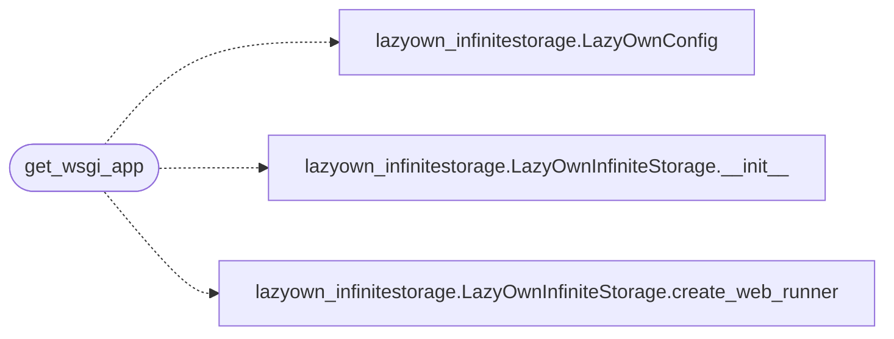

# `wsgi_app`

> Source: [wsgi_app.py:1](../../wsgi_app.py#L1) | language `py` | coverage 100.0% | [API index](../index.md)

WSGI entry point for LazyOwnInfiniteStorage web server.

## Contents

- **Functions:** [`get_wsgi_app`](#get_wsgi_app)

## Call Graph

Solid arrows stay in this module, dashed arrows leave it.



## Functions

<a id="get_wsgi_app"></a>

### `get_wsgi_app`

`function` | [wsgi_app.py:7](../../wsgi_app.py#L7)

```python
def get_wsgi_app()
```

Factory function returning a gunicorn-compatible Flask application.

*Calls:* [`LazyOwnConfig`](lazyown_infinitestorage.py.md#lazyownconfig), [`LazyOwnInfiniteStorage.__init__`](lazyown_infinitestorage.py.md#lazyowninfinitestorage-__init__), [`LazyOwnInfiniteStorage.create_web_runner`](lazyown_infinitestorage.py.md#lazyowninfinitestorage-create_web_runner)

---
