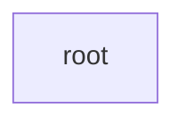

## Details

Static architecture map of 11 files (py, sh) in 1 components: root. Structure is extracted statically without LLM calls; component prose may be enriched locally.

### root (1)

root groups 10 files (py) around LazyOwnConfig, SecurityValidator, __init__, validate_file_path, validate_size. LazyOwnInfiniteStorage - Production-grade file-to-video encoder/decoder.

**Related Classes/Methods**:

- <a href="../lazyown_infinitestorage.py#L72-L155">lazyown_infinitestorage.py::LazyOwnConfig</a>
- <a href="../lazyown_infinitestorage.py#L156-L158">lazyown_infinitestorage.py::SecurityValidator</a>
- <a href="../lazyown_infinitestorage.py#L159-L161">lazyown_infinitestorage.py::__init__</a>
- <a href="../lazyown_infinitestorage.py#L162-L171">lazyown_infinitestorage.py::validate_file_path</a>
- <a href="../lazyown_infinitestorage.py#L172-L176">lazyown_infinitestorage.py::validate_size</a>
- <a href="../lazyown_infinitestorage.py#L177-L184">lazyown_infinitestorage.py::sanitize_filename</a>
- <a href="../lazyown_infinitestorage.py#L185-L191">lazyown_infinitestorage.py::validate_extension</a>
- <a href="../lazyown_infinitestorage.py#L192-L194">lazyown_infinitestorage.py::ErrorCorrector</a>
