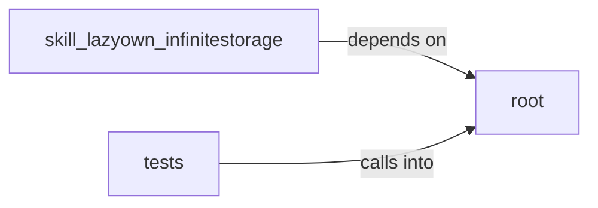

# root

root groups 8 files (py) around LazyOwnConfig, SecurityValidator, __init__, validate_file_path, validate_size. LazyOwnInfiniteStorage - Production-grade file-to-video encoder/decoder.

## root (1.1)

root groups 2 files (py) around LazyOwnConfig, SecurityValidator, __init__, validate_file_path, validate_size. LazyOwnInfiniteStorage - Production-grade file-to-video encoder/decoder.

## skill_lazyown_infinitestorage (1.2)

skill_lazyown_infinitestorage groups 1 files (py) around lazyown_infinitestorage_encode, lazyown_infinitestorage_decode, lazyown_infinitestorage_upload_to_youtube, get_tool, list_tools. MCP tools for LazyOwnInfiniteStorage integration.

## tests (1.3)

tests groups 5 files (py) around TestErrorCorrector, setup, test_encode_data_doubles_length, test_decode_data_reverses_encoding, test_decode_data_with_single_bit_error. Unit tests for ErrorCorrector Hamming(8,4) implementation.

**Files**:

- lazyown_infinitestorage.py
- skill_lazyown_infinitestorage/tools.py
- tests/test_error_correction.py
- tests/test_frames.py
- tests/test_integration.py
- tests/test_protocols.py
- tests/test_security.py
- wsgi_app.py
